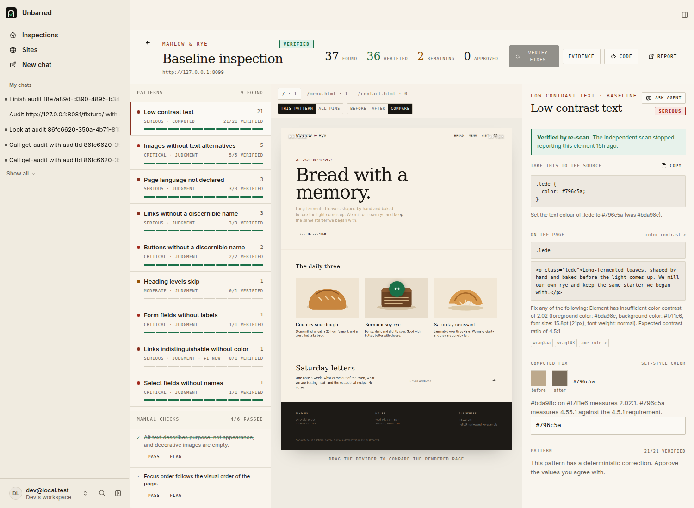
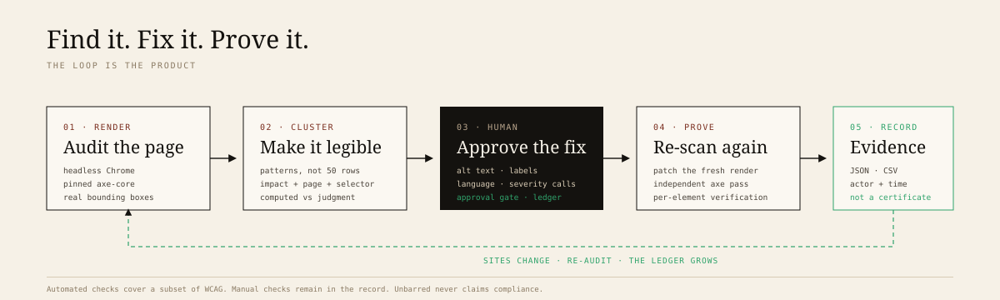
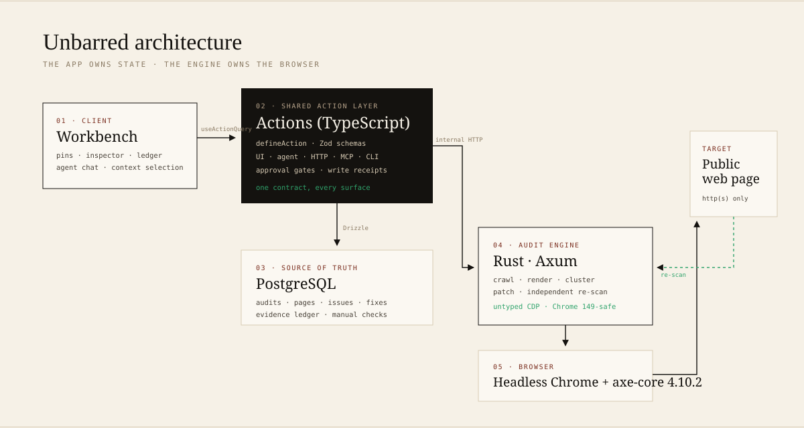

# unbarred

**Find it. Fix it. Prove it.**

Unbarred is an accessibility remediation workspace for the people who maintain
client sites. It audits a real page in a real browser, turns the findings into a
reviewable fix queue, asks a human to make the judgment calls, then re-scans the
page independently to prove what actually changed.

It is not a scanner with a nicer dashboard, and it is not an overlay. The
product is the **closed loop**: every fix has an approval, a diff, and a re-scan
result attached to it.

**Live demo:** <https://unbarred-black.vercel.app> — create an account, then choose
**Audit the demo bakery**. No payment or setup. The app runs on Vercel; the
database is Neon Postgres; the audit engine is a private Fly machine.



---

## The problem

> A scanner gives a small studio 50 cryptic failures. The client wants to know
> whether the site is "compliant". The developer has neither the accessibility
> expertise to judge every fix nor a credible way to prove the work afterwards.

The current options are bad in different ways:

- **Free scanners** (axe DevTools, WAVE) find problems and stop. Detection is
  cheap and commoditized.
- **Overlays** inject JavaScript at runtime. The disability community has
  rejected them, and the FTC's 2025 order against accessiBe (a $1M payment and a
  bar on unsubstantiated compliance claims) made the "one line of JavaScript"
  position untenable.
- **Agencies** deliver a spreadsheet audit, then quote remediation separately —
  commonly $250–$550 per page — and charge again to validate the fixes.
- **Enterprise platforms** (Level Access, Siteimprove, Deque) are priced and
  shaped for organizations with a compliance program, not a two-person studio.

The missing middle is not detection. It is **judgment plus evidence**.

The timing is not speculative:

- **95.9% of the top one million home pages had detectable WCAG 2 failures** in
  the 2026 WebAIM Million (up from 94.8% in 2025), averaging 1,257 errors per
  page.
- Federal website-accessibility lawsuits rose to roughly **3,100 in 2025**
  (Seyfarth Shaw's count), up about 27% year over year.
- The **European Accessibility Act** has been enforceable since 28 June 2025.
- Deque's own study puts automated coverage at **~57% of issues by volume**.
  The rest needs a person. A product that pretends otherwise is lying.

Sources: [WebAIM Million 2026](https://webaim.org/projects/million/),
[ADA Title III lawsuit tracker](https://www.adatitleiii.com/2026/03/federal-court-website-accessibility-lawsuit-filings-bounce-back-in-2025/),
[Deque automation study](https://www.deque.com/blog/automated-testing-study-identifies-57-percent-of-digital-accessibility-issues/),
[FTC accessiBe order](https://www.ftc.gov/news-events/news/press-releases/2025/04/ftc-approves-final-order-requiring-accessibe-pay-1-million).

## The loop



1. **Render the real page.** A Rust engine drives headless Chrome, runs a pinned
   axe-core 4.10.2 build against WCAG 2.1 A/AA plus axe best-practice rules, and
   captures each failing element's selector and bounding box.
2. **Make it legible.** Failures are clustered into patterns (low contrast,
   images without alternatives, missing labels, page language, link names…), with
   impact, page, and count. The page is shown at 1280px with numbered pins on the
   elements that actually failed.
3. **Fix with judgment.** Deterministic patterns get a computed correction (a
   colour that mathematically passes, a language attribute). Judgment calls —
   alt text, field labels, page titles — wait for a human, with an agent draft to
   react to. Approval is a real gate: the agent cannot approve on its own.
4. **Prove it.** Approved fixes are applied to a fresh render and scanned again.
   The result is recorded per element: verified, still open, or resolved without
   an approved fix. A ledger records every approval and re-scan with actor and
   timestamp. The evidence pack exports as JSON and CSV.

## What is real

Everything in the loop above is implemented and exercised end to end:

- Real crawling of up to four same-origin pages, rendered in Chrome (not parsed
  from source).
- Real axe-core findings with selectors, failure summaries, WCAG tags, and
  coordinates.
- Real computed contrast corrections (WCAG relative-luminance math) and real DOM
  patches (`set-attr`, `set-text`, `set-style`).
- A real independent re-scan that only marks a fix verified when the rule stops
  reporting that element.
- A real evidence ledger, JSON/CSV export, and printable report.
- Real Agent-Native actions shared by the UI, the in-app agent, HTTP, MCP, CLI,
  and A2A, with a `needsApproval` gate on approval actions.

The demo fixture (`/fixture/`) is a fictional bakery with deliberate barriers.
On a stable server it produces **37 barriers across 3 pages in 8 baseline patterns**;
approving all deterministic and judgment fixes takes it to **36 verified, 2 still
open** (a heading skip and a colour-only link), plus one newly surfaced pattern.
Those numbers are reproducible with the fixture, not hard-coded.

## What is limited — on purpose

Unbarred does **not** claim compliance, certification, or legal safety. It never
will. Specifically:

- Automated checks cover a subset of WCAG. Keyboard traps, reading order, focus
  management, meaningful alt text, captions, and cognitive load require a person.
  The product ships a manual checklist and keeps it in the evidence pack.
- The preview is a **stored snapshot of the rendered page**, served inert with
  scripts stripped and a sandbox CSP. Fixes are demonstrated against that
  snapshot and verified by re-rendering the live URL. The product does not commit
  to the client's repository. Code export / PR creation is the next step.
- Authenticated pages, PDFs, canvas, third-party widgets, and cross-origin iframes
  are out of scope for v1.
- SSRF protection validates the top-level URL and the post-navigation URL, and
  refuses private targets. It does not intercept every subresource request the
  rendered page makes. A public page that embeds a private address is a residual
  risk; the engine never returns response bodies from those subresources.
- A site can change between the audit and the re-scan. That is why the re-scan is
  the source of truth, and why a disappeared issue is labelled **resolved** rather
  than **verified** unless it had an approved fix.

## Architecture



```
Browser (React workbench + agent chat)
   │  useActionQuery / useActionMutation
   ▼
Actions (TypeScript, defineAction)  ──────────────►  PostgreSQL
   │  internal HTTP + bearer secret                  audits, pages, issues,
   ▼                                                  fixes, evidence, checks
Rust engine (Axum + Tokio)
   │  untyped Chrome DevTools Protocol
   ▼
Headless Chrome  ──►  target site (public http/https)
   └── pinned axe-core 4.10.2
```

**Why TypeScript for the app layer.** The hackathon mandates Agent-Native, whose
`defineAction` layer must be TypeScript to remain the single source of truth
shared by the UI, agent, HTTP, MCP, A2A, and CLI. Rebuilding that in Rust would
break the sponsor framework's core contract.

**Why Rust for the engine.** Crawling, rendering, axe execution, clustering,
DOM patching, and re-scanning are long-running, CPU and browser heavy, and
deterministic. They do not belong inside a serverless request. The engine is
stateless and job-based: `POST /v1/audits` returns an id, `GET /v1/audits/:id`
reports progress and findings, `POST /v1/rescans` applies patches and re-runs
axe. The app persists every result; the engine is a cache, not a system of
record.

The engine uses a deliberately **untyped CDP client**. Chrome 149 added fields
that broke strongly typed bindings mid-handshake; parsing every frame as JSON
keeps the transport stable across Chrome releases. There is a small compatibility
patch (`patches/@agent-native__core@0.222.1.patch`) that sends tool schemas with
`strict: true`: the OpenAI-compatible gateway used for the demo otherwise
streams valid tool arguments that the AI SDK discards, leaving every tool call
with `{}`. The same patch forwards the session cookie Better Auth creates during
sign-up on serverless hosts, where the framework's register route otherwise
returns `{ok:true}` without a browser session. The patch is applied by
`pnpm install` and documented here rather than hidden.

## Run it locally

Prerequisites: Node 22.22+, pnpm, Rust (nightly is fine), and Chromium.

```bash
pnpm install
cp .env.example .env        # add an LLM key only if you want the agent chat
```

Start the Rust engine:

```bash
cd engine
cargo build
CHROME_PATH=/usr/bin/chromium \
ENGINE_SECRET=devsecret \
ALLOW_PRIVATE_URLS=1 \
PORT=8787 \
./target/debug/unbarred-engine
```

`ALLOW_PRIVATE_URLS=1` is **development only**, so the engine can audit the
locally served fixture. Never set it in production.

Start the app in another terminal:

```bash
pnpm dev
```

Open the printed URL, sign in, and either paste a public URL or choose
**Audit the demo bakery**. The fixture is served by the app at `/fixture/`.

Environment:

| Variable | Purpose |
| --- | --- |
| `UNBARRED_ENGINE_URL` | Engine base URL, default `http://127.0.0.1:8787` |
| `UNBARRED_ENGINE_SECRET` | Bearer secret shared by the app and engine |
| `OPENAI_API_KEY` / `OPENAI_BASE_URL` | OpenAI-compatible model for agent chat |
| `ANTHROPIC_API_KEY` | Alternative model provider |
| `DATABASE_URL` | Hosted Postgres in production; PGlite locally |
| `AGENT_ENGINE` | `ai-sdk:openai`, `anthropic`, etc. |

The deterministic audit loop works **without** an LLM key. The agent chat needs
one; the app reports the missing provider instead of pretending.

## Hosted deployment

The live app uses three pieces, and only the engine is paid when it runs:

1. **Neon Postgres** (free tier) — create a project, copy the **pooled**
   connection string, then run `DATABASE_URL=... pnpm migrate:production`.
2. **Vercel Hobby** — link the project and set `DATABASE_URL`,
   `BETTER_AUTH_SECRET`, `BETTER_AUTH_URL`, `UNBARRED_ENGINE_URL`,
   `UNBARRED_ENGINE_SECRET`, `OPENAI_API_KEY`, `OPENAI_BASE_URL`, and
   `AGENT_ENGINE`. Build with `NITRO_PRESET=vercel pnpm build`, then
   `vercel deploy --prebuilt --prod`.
3. **Fly engine** — `cd engine && fly deploy --remote-only`, with
   `ENGINE_SECRET` set as a Fly secret. The app calls the engine's public URL;
   the engine sleeps when idle and wakes on the next audit.

The framework patch is required for serverless deployments: it enables strict
tool schemas and forwards the sign-up session cookie that Better Auth creates.
Do not remove `pnpm.patchedDependencies` or the patch file.

## Reproduce the demo

1. Run the fixture and the engine as above.
2. Start a baseline audit of `/fixture/` with `maxPages=3`.
3. The workbench shows **37 barriers in 9 patterns** across `/`, `/menu.html`,
   and `/contact.html`.
4. Approve **Low contrast text** with one click (21 computed fixes), then review
   the five judgment patterns. The agent can draft alt text; a person approves it.
5. Press **Verify fixes (36)**. The engine re-renders all three pages, applies
   the patches, and re-scans.
6. Expected result: **36 verified, 2 still open, 1 new pattern**. Open the
   evidence ledger and export JSON/CSV; open the printable report.

To test the agent path, open **Chat** and ask:

> Audit `/fixture/`, poll until it completes, then summarize the three largest
> patterns and what is still open.

The agent calls `start-audit`, `sync-audit`, `get-audit`, and `list-issues`, and
answers with counts from the record. It is instructed never to claim compliance.

## Agent-Native surfaces

The same actions power every surface:

| Surface | Example |
| --- | --- |
| UI | `useActionQuery("list-issues")` in the workbench |
| In-app agent | “Which pattern is still open on the menu page?” → `list-issues` |
| Approval gate | `approve-fix` and `approve-cluster` are `needsApproval`; agent calls pause for a human |
| Context | The workbench writes the selected cluster/issue into navigation state; `view-screen` reads it |
| MCP / A2A / CLI | `pnpm action get-audit --auditId <id>` and the auto-mounted MCP server |
| Live sync | Mutations invalidate action queries; the workbench polls a writing action, not a read |

Actions:

| Action | Purpose |
| --- | --- |
| `create-project` | Create or reuse a site record |
| `start-audit` | Start a baseline audit (returns an id) |
| `sync-audit` | Poll the engine and import findings |
| `get-audit` | Read the audit, patterns, checks, ledger |
| `list-audits` | Recent inspections |
| `list-issues` | Barriers with proposals and fixes |
| `save-fix` | Save a draft value |
| `approve-fix` | Human approval for one fix (gated) |
| `approve-cluster` | Approve deterministic fixes in a pattern (gated) |
| `reject-fix` | Reject with a reason |
| `start-rescan` | Apply approved fixes and start the independent scan |
| `sync-rescan` | Record verified / failed / new findings |
| `complete-manual-check` | Record a manual pass or flag |
| `export-evidence` | Build the JSON + CSV pack |
| `get-dashboard` | Workspace totals |

## Data model

`projects → audits → pages → issues → fixes`, plus `clusters`, `evidence`, and
`manual_checks`. Snapshots and patched snapshots are stored as text (size-capped,
scripts stripped) because they are the product's core artifact and must survive
an engine restart. Every query is scoped to the signed-in owner.

## Security

- **SSRF:** only public `http(s)` URLs. Embedded credentials, localhost, `.local`,
  `.internal`, link-local, loopback, and private ranges are refused; hostnames are
  resolved and every address checked; redirects are re-validated after render.
  Production does not set `ALLOW_PRIVATE_URLS`.
- **Untrusted previews:** snapshots have scripts, iframes, objects, and inline
  event handlers removed. The preview route serves them with a sandbox CSP and
  `script-src 'none'`, so opening the URL directly still cannot execute the
  audited site's code.
- **Authorization:** every action checks `ctx.userEmail` and joins through the
  audit owner. The snapshot route checks the session and ownership.
- **Engine:** bearer-authenticated, intended for private networking. No engine
  secret is exposed to the browser.
- **Secrets:** deploy-level env only; `.env` is gitignored. The demo never ships a
  user key.

## Verification

- `pnpm typecheck`
- `cargo build` in `engine/`
- Fixture corpus: 37 barriers / 9 patterns; full loop yields 36 verified / 2 open
  with the current fixture.
- Ten consecutive demo rehearsals are the target before recording (see
  `docs/demo-script.md`).
- The re-scan is adversarially tested: a fix whose rule still reports the element
  is marked **failed**, not verified. The reconciler preserves verified statuses
  and never counts a disappeared issue as verified without an approved fix.

## Hackathon notes

Built for the **Builder.io Agent-Native Hackathon** (deadline 9 November 2026).
The product targets **Grand Prize** and **Best Use of Agent-Native**. It is not a
clone of a first-party template; it starts from the Chat starter and adds a
domain, a real Rust engine, and a workflow no template ships.

The pitch in one line: **accessibility work is not a detection problem, it is a
judgment-and-proof problem — and this is the room where that work happens.**

## Roadmap

- GitHub App: turn approved fixes into pull requests against the client's repo.
- Scheduled re-audits per site, with a diff against the previous ledger.
- VPAT/ACR evidence draft from the same record (clearly labelled as a draft).
- Keyboard/focus capture in the engine, so more of the manual checklist is
  evidenced rather than asserted.
- Agency portfolios: one queue across every client site.

## Acknowledgements

[axe-core](https://github.com/dequelabs/axe-core) (Deque, MPL-2.0) does the
finding. [Agent-Native](https://www.agent-native.com/) provides the action layer,
agent loop, approvals, and MCP surface. The bakery is fictional; the failures are
deliberate.
